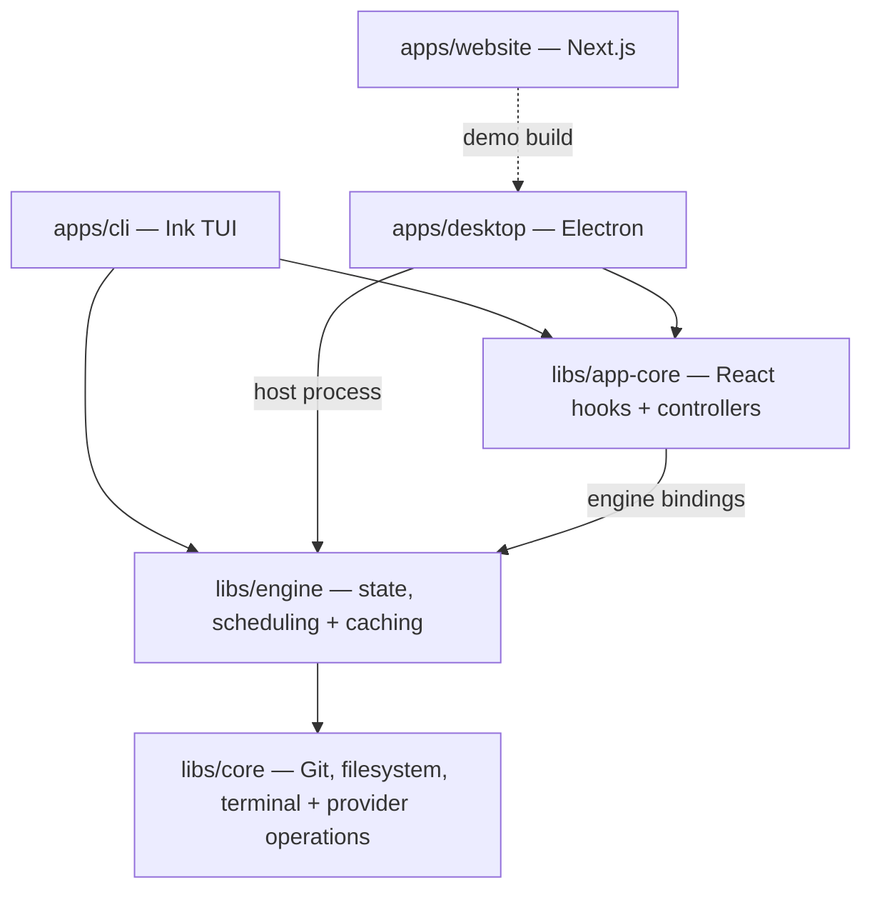

n10 is open source at
[github.com/notaharness/n10](https://github.com/notaharness/n10). See the
[Roadmap](/docs/roadmap) for its direction and the
[roadmap board](https://github.com/orgs/notaharness/projects/1) for planned work.
Look for an available issue labelled
[`good first issue`](https://github.com/notaharness/n10/labels/good%20first%20issue)
and comment before starting. If none is available, open a question asking for
a small task. Agree on the scope in an issue before starting a substantial change.

[CONTRIBUTING.md](https://github.com/notaharness/n10/blob/master/CONTRIBUTING.md)
is the full guide to setup, checks and review. Report vulnerabilities privately
as [SECURITY.md](https://github.com/notaharness/n10/blob/master/SECURITY.md) describes.

## Set up and run

Use Node 24 to match CI, Git 2.38+ and tmux 3.7+ for tests. The product supports
Node 22.12+ and tmux 3.2+. Linux source installs need `build-essential` and
`python3` for `node-pty`.

Fork the repository on GitHub, then follow the
[fork, upstream and topic-branch setup](https://github.com/notaharness/n10/blob/master/CONTRIBUTING.md#set-up)
and run `npm ci` in your checkout. Discover projects and run the app through Nx:

```sh
npx nx show projects
npx nx serve desktop                  # Desktop from source, with reload
npx nx serve cli                      # the terminal UI from source
npx nx dev website                    # this site, at http://localhost:3100
```

[Run and check](https://github.com/notaharness/n10/blob/master/CONTRIBUTING.md#run-and-check)
covers typechecking before edits, selecting tests, browser dependencies and the
Nx cache workaround for worktrees under `.claude/worktrees/`.

Ordinary unit and offline e2e tests use fake agents/providers and do not need an
agent subscription, GitHub login or integration PAT. Docker is needed for the
visual suite, not ordinary offline e2e; packaging smoke tests also use containers.
Nix is an optional Linux development environment. See the guide's
[optional tools and credentials](https://github.com/notaharness/n10/blob/master/CONTRIBUTING.md#optional-tools-and-credentials)
for the boundaries between offline tests and live use.

## Working with an agent

Ask your agent to read the root `AGENTS.md` and each nested `AGENTS.md` on the
paths it changes. These describe package boundaries, lint budgets, tmux safety
and checks. The same rules apply to changes written by hand. Shared skills live
in `.agents/skills/`; Claude plugins are optional. Review the agent's changes
before opening a PR. See
[agent context](https://github.com/notaharness/n10/blob/master/docs/agent-context.md)
for client-specific loading behavior.

## Pull requests

Use a topic branch based on `master` and Conventional Commits with a project
scope, such as `fix(desktop): …`. Link the issue and describe what the code does.
A draft PR is useful for feedback on the approach; maintainers review the scope,
behavior and code, and may ask for revisions.

First-time Actions runs may wait for maintainer approval. The required `main`
check needs no integration PAT. Fork PRs skip the live Integration job and get
an explanation in the workflow summary; a maintainer's `master` run covers live
integration after merge. A skip does not mean the live tests ran on your PR.
You do not need to supply a token. See
[after opening a pull request](https://github.com/notaharness/n10/blob/master/CONTRIBUTING.md#after-opening-a-pull-request)
for the review and CI handoff.

## How the code fits together

Desktop (Electron) and the terminal UI (Ink) are two shells over shared libraries.
`libs/core` provides Git, filesystem, terminal and provider operations.
`libs/engine` owns shared state, scheduling and caching over those operations;
`libs/app-core` supplies React hooks and controllers. The TUI runs the engine in
its own process; Desktop runs it in the host utility process and connects the
renderer through its bridge. The shells share the implementation, not one
in-memory state instance.

The website also depends on Desktop at build time to include its interactive demo.
This diagram shows the main layers; the architecture reference describes entry
points and the browser-safe boundaries.



The repository's reference docs explain the details:

- [architecture.md](https://github.com/notaharness/n10/blob/master/docs/architecture.md):
  package roles, entry points and dependency boundaries.
- [decisions.md](https://github.com/notaharness/n10/blob/master/docs/decisions.md):
  design rationale and known limitations.
- [testing.md](https://github.com/notaharness/n10/blob/master/docs/testing.md):
  test fixtures, prerequisites and CI coverage.
- [linting.md](https://github.com/notaharness/n10/blob/master/docs/linting.md):
  lint rules, budgets and exceptions.
