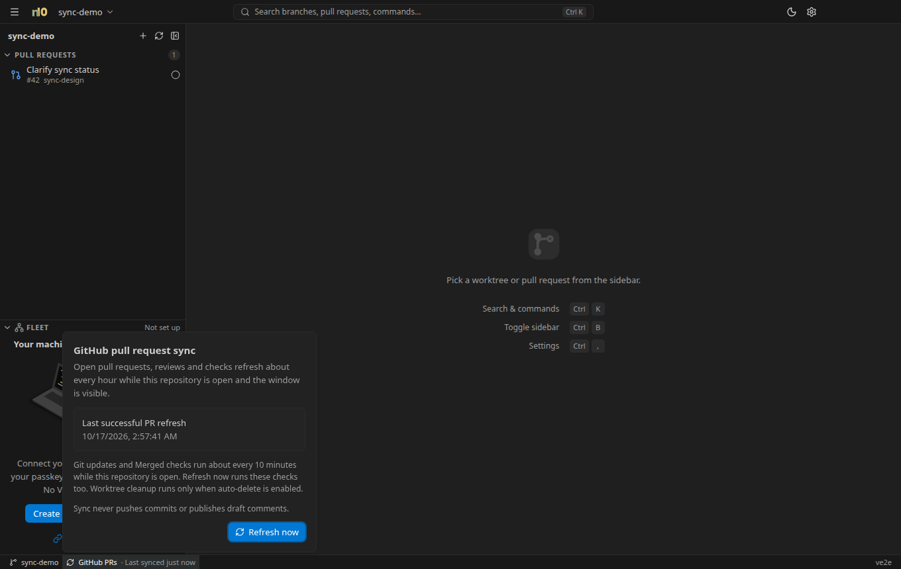
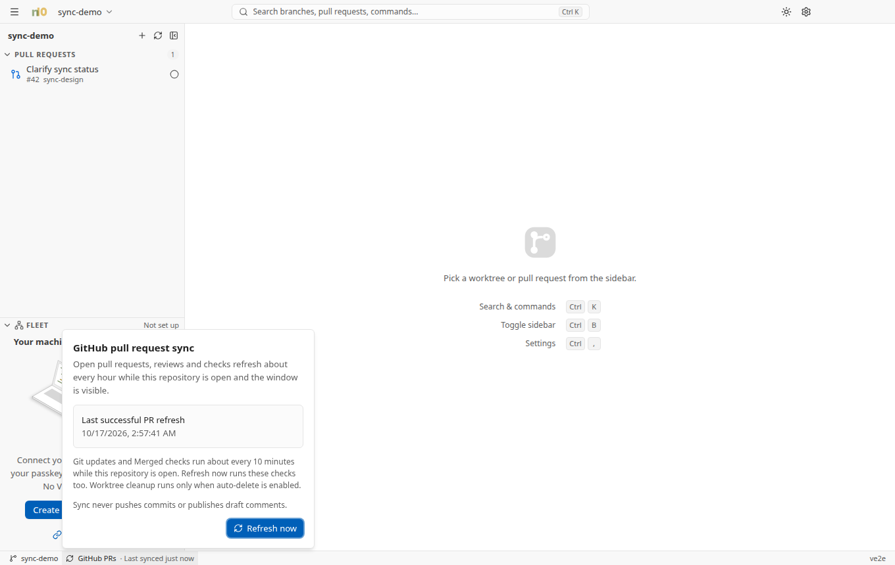
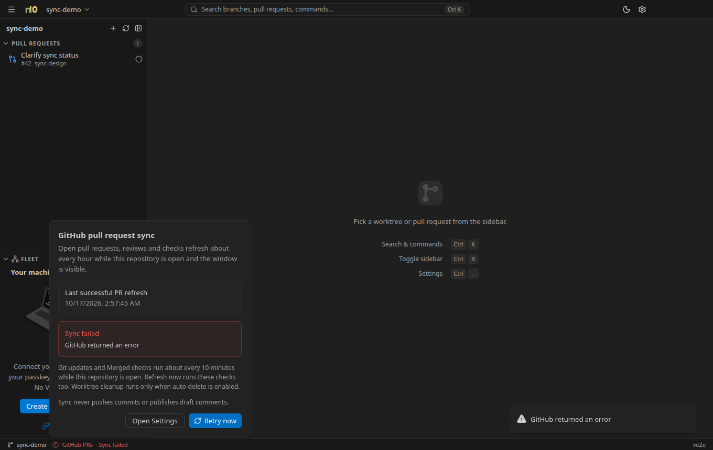
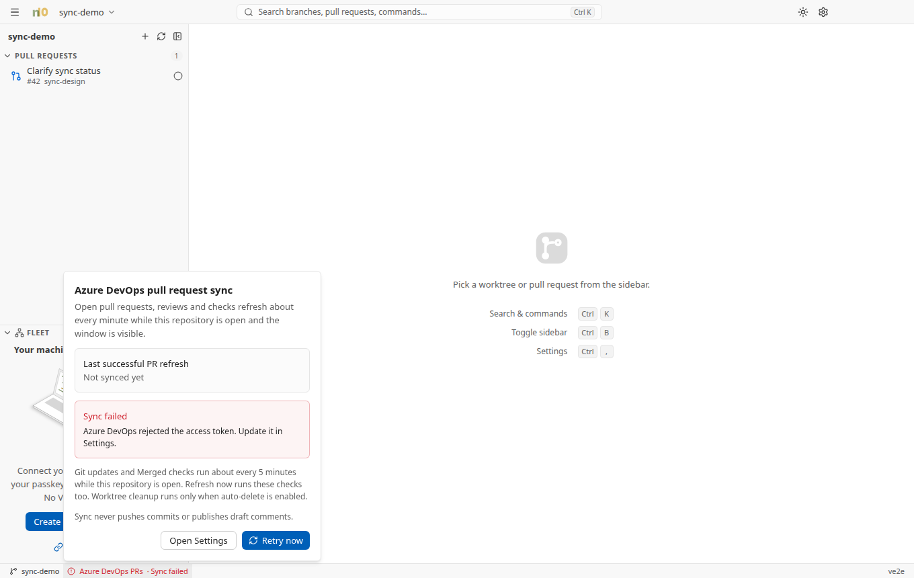

# GitHub and Azure DevOps sync

## Automatic refresh

Desktop uses two engine services for the selected repository:

| Operation              | Schedule                                                                                                                                                                                             | Effect                                                                                                                                                                     |
| ---------------------- | ---------------------------------------------------------------------------------------------------------------------------------------------------------------------------------------------------- | -------------------------------------------------------------------------------------------------------------------------------------------------------------------------- |
| Open-PR refresh        | Visible-window sidebar reads request data past `prPollInterval` (default 60 seconds). Auto-fixers and other readers can also request it.                                                             | Reads open PRs, reviews and checks. GitHub limits the list to PRs involving the configured user.                                                                           |
| Repository maintenance | On repository selection and sync configuration changes, then every `mergePollInterval` (default one hour, minimum five minutes), independently of window visibility. Requires a configured provider. | Fetches/prunes Git refs, attempts to fast-forward local main, queries merged branches, checks conflicts and removes eligible merged worktrees when auto-delete is enabled. |

The engine shares PR reads by repository, provider, project and credentials.
A failed read preserves the last successful list and timestamp; the next read
past the interval retries. Credential changes invalidate that scope. Sidebar
polling pauses while the document is hidden, but other readers can still refresh.
The displayed PR cadence is at least the sidebar’s four-second read interval.
Parked repositories retain maintenance decorations until selected again; their
PR reads use the engine's parked-repository freshness policy.

**Refresh now runs both operations.** It also clears provider PR caches and
invalidates review detail reads. Neither operation pushes commits or publishes
draft comments. A busy manual refresh queues at most one follow-up pass;
a busy maintenance timer skips its tick.

Maintenance failures preserve the last successful decorations and reach the
status bar and warning notices. A Git fetch failure still allows merge checks;
its error remains visible. If both operations fail, the status bar shows the
PR error first. `lastRemoteSyncAt` certifies only the PR list; `lastGitSyncAt`
does not certify the merged-branch query. The popover labels its timestamp
**Last successful PR refresh** to preserve that distinction.

Sources: engine `pull-requests/pull-request-list.ts`,
`repositories/repository-service.ts`, `sync/remote-sync.ts` and `sync/sync-pass.ts`;
desktop host `services/sidebar.ts` and `services/remote-sync.ts`;
renderer `lib/data/queries.ts` and `mutations.ts`.

## Status and actions

The status bar names GitHub PRs or Azure DevOps PRs and shows progress, the last
PR refresh, or a sync failure. Clicking opens an anchored, non-modal popover
with the two effective cadences and a refresh action. Cleanup is explicitly
conditional on auto-delete being enabled. Errors offer **Retry now**; only a
PR-provider error offers **Open Settings**. The host identifies the source of
the displayed error, preserving PR-error priority when both operations fail.
Missing credentials lead directly to Settings.

The popover uses the shared Radix primitive, keeps warning/error colours on hover,
and fits short windows. Escape returns focus to the trigger. Opening it does not
refresh data. The npm update segment remains beside the sync status.

## Appearance

