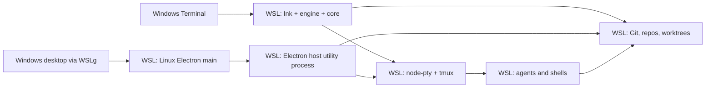

# Windows support through WSL

Status: accepted. Windows support is experimental and runs n10 inside WSL 2; tmux remains required. It supersedes the native-execution direction of [#346](https://github.com/notaharness/n10/pull/346).

## Recommendation and support boundary

Ship n10 inside WSL 2 as experimental: the app on the Windows desktop through WSLg is the primary path, and `n10 --tui` in Windows Terminal is the fallback where WSLg is unavailable. Defer a native Windows Electron shell until measured WSLg limitations justify a separate Windows-to-Linux host transport.

The recommended baseline is Windows 11 x64, current Store WSL2, Ubuntu 24.04 LTS, Windows Terminal, Linux Node/npm and tmux 3.2+. This is a deliberately narrow n10 qualification target, not the minimum OS version Microsoft permits. Other distros, ARM64, WSL1, mounted Windows repositories and native Windows agents are outside the claim. Since #386, a repository opened on WSL 1 or on a mounted Windows drive opens with a startup warning ([wsl.ts](../../libs/core/src/lib/environment/wsl.ts), [environment-notices.ts](../../libs/core/src/lib/environment/environment-notices.ts)). Missing or broken tmux must remain a startup error.

The useful deliverable is a Windows developer creating a worktree, running Claude or Codex, reviewing its diff/PR, quitting n10 and reattaching to the same tmux session, in the app on WSLg, with the TUI as the fallback. A desktop installer is not necessary for this workflow. No mux owner, replacement session manager, Windows service or native Windows terminal backend is needed.

## Where the pieces run

| Concern         | A1: TUI in WSL (fallback)                                                     | A2: App in WSL via WSLg (primary)                                                      | B: Windows Electron with WSL backend                                                          |
| --------------- | ----------------------------------------------------------------------------- | -------------------------------------------------------------------------------------- | --------------------------------------------------------------------------------------------- |
| UI              | Ink in Linux; Windows Terminal displays the WSL terminal                      | Renderer, main and host utility process are Linux processes; WSLg presents the windows | Renderer/preload/main are Windows processes; headless host runs in the selected distro        |
| Program         | Core, engine and app-core run in Linux                                        | Core/engine in Linux host; app-core in renderer                                        | Core/engine in Linux host; browser-safe renderer bindings stay Windows                        |
| Execution       | Linux node-pty attaches Linux tmux; Git, agents and worktrees are Linux       | Same, with the existing utility-process boundary                                       | Linux node-pty/tmux remain unchanged; host RPC and terminal bytes cross an explicit transport |
| Install         | WSL/distro, Linux prerequisites, npm package                                  | Same plus Electron dependencies, or Linux `.deb`; WSLg/graphics qualification          | Windows installer plus a matched Linux host/runtime distribution and distro bootstrap         |
| Files           | Linux home, including repo, worktrees, config, credentials and native modules | Same; Linux folder picker sees Linux paths                                             | Backend owns all repository I/O; UI stores distro/user-qualified Linux paths                  |
| Sessions/socket | Local Linux Unix socket, same distro and user                                 | Same                                                                                   | Windows never opens the tmux socket; backend handles all access                               |
| Updates         | Existing npm update path runs inside WSL                                      | npm path, or manual Linux package replacement                                          | Coordinate signed Windows shell and Linux host versions; reject incompatible protocols        |
| Main cost       | Qualification, onboarding and external integration gaps                       | Graphics, sandbox, clipboard, browser and desktop integration QA                       | New transport, lifecycle, path model, deployment and cross-OS test matrix                     |

WSLg supports Linux X11/Wayland apps on WSL2 and integrates their windows into Windows. It is not a complete Linux desktop environment; that distinction matters for portals, tray and notifications. [Microsoft GUI guide](https://learn.microsoft.com/en-us/windows/wsl/tutorials/gui-apps)

### Other credible options

A Windows shortcut launching `wsl.exe` into `n10`, or a Linux desktop entry exposed through WSLg, can improve discovery without moving execution; WSLg already puts a `.deb`'s desktop entry in the Start menu. This is the preferred convenience increment after qualification; the shortcut must select the intended distro/user and not inherit a Windows working directory accidentally. WSL's documented commands support explicit distro, user and executable selection. [WSL commands](https://learn.microsoft.com/en-us/windows/wsl/basic-commands)

A browser frontend served from WSL is credible longer term, but the existing `apps/cli-wterm-host` is a TUI testing bridge, not a production desktop server. Turning it or the desktop demo into a product entails authenticated HTTP/WebSocket access, origin checks, lifecycle, filesystem UI and browser clipboard/notification permissions. It avoids Electron packaging but adds another shell and exposed endpoint. Do not make it a prerequisite for Windows support.

Treating WSL as a Beam/SSH remote machine is also credible for an already remote-capable controller. It retains Linux tmux, but does not by itself relocate the current desktop's local repository engine, discovery and host services. It introduces enrolment or SSH setup merely to reach a local distro. Keep Beam for actual fleet use; do not require it as the local WSL transport.

## Files, tools and desktop integration

### Filesystem and identity

Clone into `~/src/<repo>` inside the distro. Keep worktrees on that Linux filesystem, including an explicitly configured worktree base. Install Node, npm, n10, agents and their dependencies there. Do not reuse Windows `node_modules`, Windows Git or npm's Windows executable shims.

`/mnt/c/...` is a mounted Windows drive; `\\wsl$\Ubuntu-24.04\home\...` (also exposed through `\\wsl.localhost\...`) is Windows access to Linux files. Neither UNC spelling is a Linux working directory. Microsoft recommends keeping files beside the OS running the tools for performance; cross-filesystem Git/npm workloads are a poor default. Windows Explorer access is useful for inspection, not as n10's execution path. [Filesystem guidance](https://learn.microsoft.com/en-us/windows/wsl/filesystems), [interop and path translation](https://learn.microsoft.com/en-us/windows/dev-environment/wsl-interop)

n10 warns at startup when a repository is on a mounted Windows drive (#386); `/mnt/c` stays unqualified rather than inventing an absolute performance guarantee. Qualification should record worktree creation, Git status/diff and file-watch behavior on Linux storage, plus a mounted-drive comparison. Case sensitivity, symlinks, executable modes and line endings make mixed Windows/Linux Git access another reason to avoid sharing one checkout between both toolchains.

For B, identify a repository by distro, Linux user and backend-canonical absolute path. A Windows file dialog returning a UNC path must not feed Windows `realpath`, Git or watchers and then claim Linux identity. Prefer a backend directory browser; translate only for explicit Explorer/editor actions. A distro switch changes the execution target and cannot silently reuse another distro's saved sessions or credentials.

### Agents, Git authentication and SSH

Install and authenticate Claude/Codex as Linux CLIs in the chosen distro, using each vendor's supported Linux/WSL installation. Check their resolved executables and versions from the same environment n10 uses. Claude explicitly documents WSL installation. [Claude setup](https://code.claude.com/docs/en/setup)

Do not assume a successful Windows installation or login supplies Linux credentials. Run a real agent under its normal sandbox and verify launch, prompt delivery, exact-session resume where supported and Orchestra reporting. Config and account selectors remain Linux paths. The host launcher must reproduce the intended Linux PATH/HOME rather than depend on an interactive shell's startup output.

Git runs in WSL for every option. Default onboarding can use Linux `gh auth login` and its Git setup for GitHub, or the user's existing Linux credential helper. Offer Windows Git Credential Manager as a documented opt-in for HTTPS: Microsoft supports invoking it from WSL, but its Windows-side Git configuration is a separate concern. GCM does not authenticate SSH remotes. [Microsoft Git/WSL guide](https://learn.microsoft.com/en-us/windows/wsl/tutorials/wsl-git)

For SSH, recommend an agent and keys managed inside WSL with a valid Linux `SSH_AUTH_SOCK`. Windows OpenSSH/third-party agent bridges are optional user integrations, not phase-1 dependencies. Test authentication from an n10-created tmux session and after reopening: tmux retains server environment, so a socket that worked in the launching terminal may be stale in an existing session. Never copy private keys automatically or inject the complete credential environment into command-line arguments.

### Links, Beam passkeys and networking

Inside WSL with interop, `urlOpenCommand`/`windowsOpener` ([open-url.ts](../../libs/core/src/lib/environment/open-url.ts)) open http(s) links with `wslview`, or `explorer.exe` if that is missing, spawned argv-only. A user-set `BROWSER` keeps `xdg-open`. Desktop main uses it through [open-external.ts](../../apps/desktop/src/main/open-external.ts). A click reaching the Windows default browser on a real desktop is still unverified; the docs keep a copyable URL fallback.

Beam belongs in WSL alongside tmux for A and B: Linux binary, Linux control socket, Linux config and machine identity. Its existing ceremony prints a URL/QR code and accepts completion in another browser or on a phone; the browser result returns through its relay ceremony, not a callback that requires a Windows process to open the distro's Unix socket. Thus Windows browser handoff does not require native Windows Beam. [Beam CLI ceremony](https://github.com/notaharness/beam/blob/main/docs/07-cli.md), [ceremony implementation](https://github.com/notaharness/beam/blob/main/internal/ceremony/ceremony.go)

Use the Windows browser or phone for passkeys. Do not equate Windows Hello availability with Beam compatibility: Beam requires WebAuthn PRF from the browser, OS and credential provider together. Qualify one real combination and document the fallback; fake-authenticator CI cannot prove this. Beam enrolment remains optional for local work and cannot block phase 1.

Agent OAuth flows are separate: any localhost callback must be tested from the Windows browser to the WSL listener. Windows-to-WSL localhost access is documented; NAT, mirrored networking, VPN/firewall policy and reverse-direction access differ. Do not add port forwarding, require mirrored mode or bind an unauthenticated service to all interfaces merely for this plan. [WSL networking](https://learn.microsoft.com/en-us/windows/wsl/networking)

### Clipboard and notifications

A1 uses Windows Terminal's text selection/paste; verify multiline paste, Unicode, Ctrl+C and keybindings with the actual TUI. Do not promise Kitty graphics or image clipboard support in the initial terminal matrix. n10-specific clipboard operations need their own test rather than being inferred from ordinary terminal paste.

A2 can use WSLg's advertised clipboard integration, but must test Electron/xterm text copy/paste, focus and image behavior independently. WSLg implements clipboard integration in its RDP backend. [WSLg architecture](https://github.com/microsoft/wslg)

Linux notification delivery to the Windows notification center is not established by GUI rendering. Phase 1 requires in-app state/errors, not Windows toasts; A2 may advertise system notifications only after testing the installed D-Bus/desktop-service path. B can use native Electron clipboard/notification APIs through shell adapters, with app identity and installer registration qualified separately. Do not create a background notification service for the minimal slice.

### Packaging, signing and updates

For A1 use `@notaharness/n10` installed with Linux npm; `n10 --tui` avoids the Electron download path. Preserve the existing engine update preferences and Linux npm update/restart behavior. User-owned npm installation avoids requiring elevation for updates. Qualification must cover shutdown/drain, upgrade and reattach.

For A2 start with the same npm install and `n10`; alternatively use the existing Linux `.deb` and its `n10-desktop` entry. Prefer `.deb` over making AppImage/FUSE setup part of the first WSLg guide. Linux packaging already stages Linux node-pty and Beam in [electron-builder.yml](../../apps/desktop/electron-builder.yml). Test a clean install, launch, uninstall and update in WSL, with Chromium sandbox enabled. Disabling the sandbox is not the support recipe.

An npm install's setuid `chrome-sandbox` is unusable, so the launcher ([desktop-sandbox.ts](../../apps/cli/src/commands/desktop-sandbox.ts), #388) keeps the sandbox through unprivileged user namespaces when an `unshare --user --map-root-user --net --pid --fork` probe passes, unless AppArmor's `apparmor_restrict_unprivileged_userns` is 1. WSL 2 has no such restriction and runs sandboxed: CI verified a renderer in seccomp mode 2 in its own user namespace. Otherwise it falls back to `--no-sandbox` with a warning; `N10_NO_SANDBOX=1` forces that fallback, and the Windows guide (#389) points to the `.deb`.

There is no Windows executable to Authenticode-sign in A. Retain existing release integrity/distribution practices; packaged Linux updates remain manual/package-managed. Electron's built-in `autoUpdater` does not support Linux. [Electron updater](https://www.electronjs.org/docs/latest/api/auto-updater)

B needs a real Windows distribution/signing decision and a matching Linux payload/runtime; #349 is only installer groundwork. Its unsigned renderer smoke does not establish a functional WSL application. Recommend manual upgrades for a B prototype and a version handshake before repository operations; production automatic updates must stage both sides safely and preserve tmux sessions across restart. Never let independent latest-version installs silently mix host contracts.

## Architectural fit and the cost of a native shell

The [architecture](../architecture.md) and [decisions](../decisions.md#tmux-sessions-and-transport) already favor A: the engine is Node-only and shells are adapters; tmux stays outside the UI lifetime. Linux `/proc` discovery, POSIX shell resolution, session-bin wrappers, filesystem watches and agent launch paths remain in their existing environment. Desktop and TUI share implementations, not one engine process/cache.

[SessionBackend](../../libs/terminal/src/lib/session-backend.ts) separates connection state from hosted-process state, and `dispose` from `kill`. This is exactly what a WSL disconnect requires. It does not abstract Git, configuration, discovery or the desktop host; adding a WSL terminal backend alone would leave Windows-side repository operations in the wrong OS. Keep tmux's tags, native incarnation guards and socket access in Linux.

[host-process.ts](../../apps/desktop/src/main/host-process.ts) forks an Electron utility process; [host-worker.ts](../../apps/desktop/src/main/host-worker.ts) uses `process.parentPort`. [host-protocol.ts](../../apps/desktop/src/main/host-protocol.ts) already groups invokes, results, viewer events and reverse ShellCalls. This is a useful composition seam, not a network-ready protocol: payloads include `unknown`, and lifecycle assumes a local utility process. Electron's public `utilityProcess.fork` takes a JavaScript module, not a foreign Linux executable. [Electron utilityProcess API](https://www.electronjs.org/docs/latest/api/utility-process)

If B is justified, use public child-process APIs to launch `wsl.exe --distribution <distro> --user <user> --exec <absolute-linux-host>` with dedicated stdin/stdout pipes. This is a proposed new adapter, not an Electron workaround or a capability of the current bridge. First prove binary-clean duplex I/O, exit/lifeline behavior and argument boundaries. The Linux host owns PTYs; Windows needs no ConPTY for agent sessions.

The B prototype must establish these boundaries before any broad refactor:

- Extract host bootstrap from Electron `parentPort` without moving domain behavior out of core/engine; provide a Linux Node runtime and correctly built native modules.
- Define bounded, validated framing, request IDs, ordered terminal streams, flow control, viewer cancellation, errors and a version/capability handshake. Stdout is protocol-only; logs use stderr. Private inherited pipes avoid a publicly listening service.
- Preserve no-replay semantics for mutations whose reply is lost. On reconnect, reconcile sessions and repository state; never automatically rerun input, agent creation or Git mutation.
- Keep shell calls for menus, browser, clipboard and Windows UI in main; move Beam daemon spawning/ownership and Linux update/session-bin paths into the Linux adapter. The current reverse `spawnDaemon` call must not accidentally start Windows Beam.
- On pipe EOF, detach PTY clients, stop app-owned helpers and drain accepted work under existing engine rules. Closing the UI must not kill tmux. A stopped distro/reboot really ends Linux processes; saved tabs may offer explicit resume, never pretend to reattach.
- Test closing/crashing Windows main and the Linux host independently. Do not assume killing `wsl.exe` kills its Linux descendants, or use `wsl --shutdown` as application cleanup.

## Disposition of the paused Windows work

This assessment uses the linked PR descriptions and targeted diffs. Reuse concepts or independently justified fixes; do not merge the native stack as a WSL prerequisite.

| Work                                                                           | Reusable evidence or idea                                                                                          | Unnecessary for this direction                                                                                                    |
| ------------------------------------------------------------------------------ | ------------------------------------------------------------------------------------------------------------------ | --------------------------------------------------------------------------------------------------------------------------------- |
| [n10 #346](https://github.com/notaharness/n10/pull/346), Windows design        | Layer boundaries, explicit identity, no uncertain mutation replay, realistic agent/packaging qualification         | Native NTFS baseline, optional tmux, managed owner, mux protocol and Git Bash adaptation                                          |
| [#348](https://github.com/notaharness/n10/pull/348), ConPTY/Job Object/mux IPC | Windows Electron viability and adversarial IPC testing are references if B is pursued                              | Koffi, kill-on-close jobs for agent ownership, authenticated mux named pipe and POSIX mux startup lock; WSL agents belong to tmux |
| [#351](https://github.com/notaharness/n10/pull/351), session target            | Distinguishing native session identity from a registry label is sound; retain independently needed saved-tab fixes | A mux target variant or transport-neutral migration solely for Windows; A still has one tmux target type                          |
| [#354](https://github.com/notaharness/n10/pull/354), catalog seam              | Exact incarnation guards and explicit launch plans remain important                                                | Generalizing every resolver around a second local backend; B moves the whole host, not only its session catalog                   |
| [#356](https://github.com/notaharness/n10/pull/356), managed owner             | Explicit resume after actual process loss remains useful                                                           | No-tmux fallback, owner/client election and quit-kills-sessions semantics conflict with the tmux requirement                      |
| [#358](https://github.com/notaharness/n10/pull/358), one-shot mux              | Bounded messages and `OUTCOME_UNKNOWN` are useful transport design lessons                                         | `n10 mux`, managed catalog/screen, TSV interface, Git Bash Orchestra seam and no-tmux CI                                          |
| [#349](https://github.com/notaharness/n10/pull/349), Windows x64 installer     | NSIS per-user packaging, shortcuts, installer/uninstaller smoke and icon resources may support B                   | Shipping a Windows installer for A; bundling Windows node-pty or treating a renderer-only smoke as WSL support                    |
| [beam #55](https://github.com/notaharness/beam/pull/55), Windows control       | General control-stdio proxy and lifecycle tests may have independent value                                         | Windows named pipes, ACL/lock implementation, console adapter and ShellExecute for a Linux Beam daemon                            |
| [beam #56](https://github.com/notaharness/beam/pull/56), Windows exec          | Argument, environment and process-lifetime test cases                                                              | Native Windows exec, per-exec Job Objects and Windows mailbox qualification as n10 WSL dependencies                               |
| [beam #57](https://github.com/notaharness/beam/pull/57), Windows distribution  | Packed-install tests and release integrity checks                                                                  | Windows Beam/beamtest binaries, npm win32 package and its publishing setup; all proposed WSL backends consume Linux binaries      |

Keep Orchestra's Bash/tmux integration inside WSL. No Git Bash mux translation, Windows inbox transport or native remote mux stream is required. Beam's independent native-Windows product goals can be decided separately. Do not remove unrelated security fixes or merged restore work merely because it appears in a stacked diff.

## Phases and acceptance gates

### Phase 1 — experimental release: the app on WSLg plus the TUI fallback, npm install

1. Publish a focused setup/troubleshooting guide: Windows `wsl --install -d Ubuntu-24.04`, reboot if requested, create the Linux user, install Linux Git/tmux/Node/npm and agents, authenticate, clone in `~/src`, install n10 with npm and run `n10`; `n10 --tui` only without WSLg. The guide must pin the Node requirement from the release manifest rather than copy a possibly stale apt default.
2. Verify executable resolution with `command -v node npm git tmux claude codex` and `node -p 'process.platform'` (expected `linux`). Check `tmux -V`, `git --version` and agent versions; report missing tools individually.
3. Run the offline CLI and desktop e2e suites in real WSL2 (hosted CI, below).
4. Document terminal clipboard and browser fallback, Linux SSH/GCM choices, and shutdown semantics.
5. Public docs label Windows experimental until the qualification gate passes.

### Qualification gate — removes the experimental label

On a real Windows 11 x64 desktop with the baseline above, run `wsl --update`, check WSLg, and exercise npm `n10` and the packaged `.deb` with sandbox enabled: host startup, rendering/input, diff/review navigation, tabs, font/DPI behavior, clipboard, link opening, folder selection, theme and quit/reconnect. Test GPU defaults first; record hardware/driver failures without promising a global workaround. Complete one Claude and one Codex worktree workflow with normal sandboxing, Git fetch/push, review display and resume, in the app and in the TUI.

Test host crash, Windows sleep/wake, WSL restart, npm update/restart and package replacement. Close n10 and Windows Terminal, wait more than a minute with no WSL terminal open, then reopen and reattach to the same live agent while the distro is running. Fresh install works without native Windows Node/Git; worktree create/reuse and guarded removal work; Unicode, resize and paste work in the TUI; missing tmux errors clearly. Reboot/distro termination is explicitly not session persistence. Keep notifications explicitly limited until verified. Acceptance requires a usable installed app on a real Windows desktop, not an Xvfb screenshot.

### Phase 3 — optional native shell feasibility, then a separate decision

Only start if WSLg produces concrete blockers (for example input/accessibility or desktop integration). Prototype the B pipe transport and Linux host bootstrap, then one repo/open/diff/terminal/reattach flow and shell browser/clipboard calls. Decide host distribution/versioning and signing before productizing. The decision can be “WSLg is sufficient”; this is not a commitment to a second desktop architecture.

## Testing strategy and first experiments

Existing Linux unit, CLI and desktop e2e remain the bulk of regression coverage. A Windows process running Linux-like fixtures is not a WSL test, and Linux Xvfb is not a WSLg test.

Hosted `windows-2025` runners boot WSL2 (#385, [wsl.yml](../../.github/workflows/wsl.yml)). The job imports a pinned Ubuntu 24.04 rootfs as a WSL 2 distro and fails unless the distro's kernel is `*-microsoft-standard-WSL2`; it never falls back to WSL1 or counts a skipped job as coverage. It runs nightly (`cron: 17 3 * * *`), on `workflow_dispatch`, and on pull requests touching `.github/workflows/wsl.yml` or `tools/wsl/**`. [Runner WSL setup](https://github.com/actions/runner-images/blob/main/images/windows/scripts/build/Install-WSL2.ps1), [GitHub runner reference](https://docs.github.com/en/actions/reference/runners/github-hosted-runners)

The job clones the tested revision into the distro's Linux filesystem, runs `npm ci` there, then `cli-e2e` and the WSL detection specs against the real kernel. `desktop-e2e` runs on Xvfb inside WSL: at WSLg's 1024×768 headless output 10 tests fail on layout. WSLg itself gets a sandboxed launch smoke of the npm package's `n10`. A 120 s unattended check proves a tmux session outlives the `wsl.exe` that started it. Use scripted agents, scratch HOME/socket directories and unset `TMUX`; terminate only fixture-owned sessions. No real agent credentials or production Beam ceremonies in CI. Cache keys must distinguish Linux architecture/runtime, not merely the outer Windows runner.

Should hosted virtualization become unreliable, a disposable self-hosted Windows 11 WSL2 runner is the contingency. WSLg input, GPU, clipboard, Windows browser/PRF, sleep and notification behavior require an interactive Windows machine regardless. Automated GUI coverage can follow once that environment is reproducible.

| First experiment                                | Evidence required                                                               | Consequence                                                                         |
| ----------------------------------------------- | ------------------------------------------------------------------------------- | ----------------------------------------------------------------------------------- |
| Clean TUI install and actual agent workflow     | Versions, commands, launch/resume/report and Git-auth results                   | Determines whether phase 1 is docs-only or needs narrow fixes                       |
| Close/reopen, host crash, distro stop and sleep | Session identity/process survival versus reconnect state                        | Establishes honest lifetime guarantees; no auto-respawn of missing agents           |
| Browser handoff and Beam PRF                    | Windows browser or phone completes ceremony; opener failure remains recoverable | Adapter only if needed; fleet can remain unqualified without delaying local support |
| Packaged Electron under WSLg                    | Sandbox-on install/render/input/clipboard and update result                     | Determines whether A2 is supportable before investment in B                         |
| Hosted WSL2 runner boot                         | Actual WSL2 distro and offline e2e results                                      | Resolved by #385: hosted `windows-2025`, nightly                                    |
| Native shell transport, only if needed          | Duplex bytes, backpressure, EOF/crash and version mismatch                      | Go/no-go for B before repository-wide changes                                       |

## Open questions with recommended defaults

| Question                                                | Recommendation                                                                                                                                    |
| ------------------------------------------------------- | ------------------------------------------------------------------------------------------------------------------------------------------------- |
| Which Windows/distro/architecture baseline?             | Windows 11 x64 + current Store WSL2 + Ubuntu 24.04 LTS; qualify ARM64 and other distros separately.                                               |
| What is the initial support promise?                    | Experimental: n10 on WSLg (primary) and `n10 --tui` (fallback), installed with Linux npm; the label stays until the real-desktop gate passes.     |
| Must repos on `/mnt/c` work?                            | Do not qualify initially; recommend Linux home for both repo and worktrees. Measure before broadening.                                            |
| Which Git/SSH credentials should onboarding use?        | Linux authentication by default, optional documented Windows GCM for HTTPS; no automatic key/config migration or SSH bridge.                      |
| Must native passkeys and notifications work for launch? | No; copyable Beam ceremony/phone fallback, in-app notifications. Qualify PRF explicitly before claiming fleet support.                            |
| How many distros/users can one n10 target?              | One executing distro/user per launch; no combined inventory. Any future native shell stores explicit target identity.                             |
| What survives close, sleep or reboot?                   | UI close detaches while WSL is running; test sleep/reconnect; no survival promise across distro termination/reboot and no implicit agent restart. |
| What is the CI platform?                                | Hosted `windows-2025` WSL2, nightly; manual WSLg acceptance on a real Windows 11 machine.                                                         |
| When is native Windows Electron justified?              | Only by measured WSLg shortcomings; a separate host-transport decision, not a prerequisite. Reuse #349 then, with a signing/update plan.          |
| What happens to the paused stacks?                      | Supersede their n10 native-execution roadmap after review; preserve independent fixes and leave Beam's native scope to its own decision.          |
